<!--
  Profile README for github.com/Sr1ya
  All artwork in ./assets is hand-drawn animated SVG with dark + light variants.
  Regenerate with: python gen/gen.py
-->

  <picture>
    <source media="(prefers-color-scheme: dark)" srcset="./assets/hero-dark.svg">
    
  </picture>

  
  
  
  
  

 

<!-- ───────────── 01 · ABOUT ───────────── -->
<picture>
  <source media="(prefers-color-scheme: dark)" srcset="./assets/sec-about-dark.svg">
  
</picture>

<picture>
  <source media="(prefers-color-scheme: dark)" srcset="./assets/terminal-dark.svg">
  
</picture>

  

<!-- ───────────── 02 · STACK ───────────── -->
<picture>
  <source media="(prefers-color-scheme: dark)" srcset="./assets/sec-stack-dark.svg">
  
</picture>

<picture>
  <source media="(prefers-color-scheme: dark)" srcset="./assets/stack-dark.svg">
  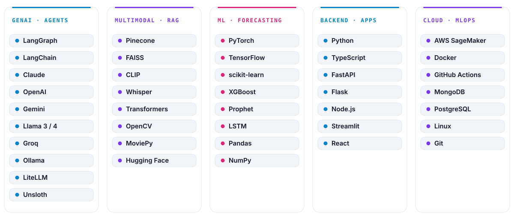
</picture>

  

 

<!-- ───────────── 03 · FEATURED ───────────── -->
<picture>
  <source media="(prefers-color-scheme: dark)" srcset="./assets/sec-projects-dark.svg">
  
</picture>

  <a href="https://github.com/Sr1ya/Infra-Pulse"><picture><source media="(prefers-color-scheme: dark)" srcset="./assets/card-infra-pulse-dark.svg"></picture></a>
  <a href="https://github.com/Sr1ya/Text_to_Video"><picture><source media="(prefers-color-scheme: dark)" srcset="./assets/card-text-to-video-dark.svg"></picture></a>

  <a href="https://github.com/Sr1ya/ledgerpe-kyc-agent"><picture><source media="(prefers-color-scheme: dark)" srcset="./assets/card-kyc-agent-dark.svg"></picture></a>
  <a href="https://github.com/Sr1ya/ledgerpe-routing-agent"><picture><source media="(prefers-color-scheme: dark)" srcset="./assets/card-routing-agent-dark.svg"></picture></a>

  <a href="https://github.com/Sr1ya/ai-services-agency-langgraph"><picture><source media="(prefers-color-scheme: dark)" srcset="./assets/card-agency-dark.svg"></picture></a>
  <a href="https://github.com/Sr1ya/leadflow-agent"><picture><source media="(prefers-color-scheme: dark)" srcset="./assets/card-leadflow-dark.svg"></picture></a>

  <a href="https://github.com/Sr1ya/gprmax_finetuned"><picture><source media="(prefers-color-scheme: dark)" srcset="./assets/card-llama-ft-dark.svg"></picture></a>
  <a href="https://github.com/Sr1ya/Multimodal-AI-SaaS"><picture><source media="(prefers-color-scheme: dark)" srcset="./assets/card-emotion-dark.svg"></picture></a>

 

<!-- ───────────── 04 · MORE ───────────── -->
<picture>
  <source media="(prefers-color-scheme: dark)" srcset="./assets/sec-more-dark.svg">
  
</picture>

| | Project | What it does | Stack |
|:-:|---|---|---|
| 🩺 | **[Medical Chatbot (RAG)](https://github.com/Sr1ya/End-To-End-AI-Medical-Chatbot)** | Retrieval-grounded medical Q&A over Pinecone-indexed documents | `LangChain` `Pinecone` `GPT` `Flask` |
| 📄 | **[AI Resume Builder & ATS Optimizer](https://github.com/Sr1ya/AI-Resume-Analyzer)** | Dual-LLM resume parsing, ATS scoring & rewriting; PDF / DOCX / LaTeX export | `OpenAI` `Gemini` `NLP` |
| 📈 | **[Trader Behavior Insights](https://github.com/Sr1ya/Trader-Behavior-Insights)** | Hyperliquid trades vs. the Bitcoin Fear/Greed index — prediction & trader clustering | `XGBoost` `Random Forest` `Streamlit` |
| 🚗 | **[Vehicle Insurance MLOps](https://github.com/Sr1ya/Vehicle-Insurance)** | MongoDB ingestion → training → CI/CD deployment, end to end | `MongoDB` `Docker` `CI/CD` |
| ✍️ | **[Digit Recognizer](https://github.com/Sr1ya/Digit-Recognizer)** | Handwritten digit classifier built from first principles | `NumPy` `Pandas` |

 

<!-- ───────────── 05 · ACTIVITY ───────────── -->
<picture>
  <source media="(prefers-color-scheme: dark)" srcset="./assets/sec-stats-dark.svg">
  
</picture>

  <picture>
    <source media="(prefers-color-scheme: dark)" srcset="./profile-3d-contrib/profile-night-rainbow.svg">
    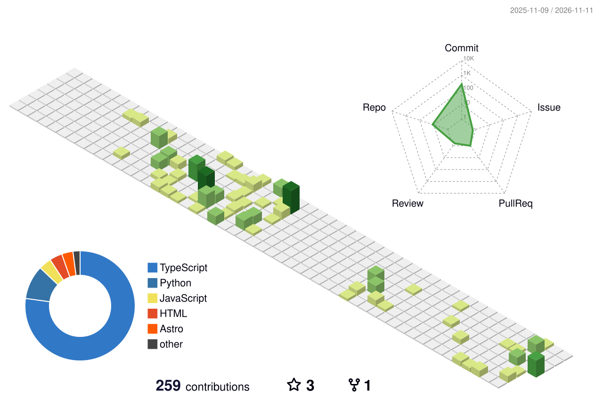
  </picture>

  <picture>
    <source media="(prefers-color-scheme: dark)" srcset="https://github-readme-stats.vercel.app/api?username=Sr1ya&show_icons=true&include_all_commits=true&count_private=true&hide_border=true&bg_color=0f172a&title_color=00c6ff&icon_color=7c3aed&text_color=e2e8f0&ring_color=f472b6">
    
  </picture>
  <picture>
    <source media="(prefers-color-scheme: dark)" srcset="https://streak-stats.demolab.com/?user=Sr1ya&hide_border=true&background=0f172a&ring=7c3aed&fire=f472b6&currStreakLabel=00c6ff&sideLabels=e2e8f0&currStreakNum=e2e8f0&sideNums=e2e8f0&dates=94a3b8&stroke=1e293b">
    
  </picture>

  <picture>
    <source media="(prefers-color-scheme: dark)" srcset="https://raw.githubusercontent.com/Sr1ya/Sr1ya/output/github-snake-dark.svg">
    
  </picture>

 

<!-- ───────────── 06 · CONNECT ───────────── -->
<picture>
  <source media="(prefers-color-scheme: dark)" srcset="./assets/sec-connect-dark.svg">
  
</picture>

  
  
  
  
  
  
  
  

 

<picture>
  <source media="(prefers-color-scheme: dark)" srcset="./assets/footer-dark.svg">
  
</picture>
