<picture>
  <source media="(prefers-color-scheme: dark)" srcset="./assets/banner-dark.svg">
  
</picture>

I build agentic systems and applied GenAI that hold up in production — agents with deterministic guardrails, explainability, and cost/latency observability built in from the start. Lately I've also been shipping small, fast native apps in Rust + Tauri.

- **Now** — AI Engineer at ZyFlux LLP, building AI products and automation
- **Belief** — LLMs reason and explain; decisions live in deterministic, auditable code
- **Learning** — LLM evals, guardrails, agent memory
- **Reach me** — [sriyaflows@gmail.com](mailto:sriyaflows@gmail.com)

 

## Experience

| | | |
|---|---|---|
| **AI Engineer** | ZyFlux LLP | 2026 — now |
| **AI Engineer** | LedgerPe — KYC agent, payment-routing engine | 2025 — 2026 |
| **GenAI Engineer** | StartCoding AI | 2025 |
| **B.E. AI & ML** | | 2020 — 2024 |

 

## Recent

| | | |
|---|---|---|
| **[Muxo](https://github.com/Sr1ya/muxo)** | Download files and torrents faster by combining every network you have — Wi-Fi, Ethernet, USB phone — at once. Crash-safe resume, browser extension, under 10 MB idle RAM. | Rust · Tauri · React |
| **[ByTune](https://github.com/Sr1ya/bytune-rs)** | Cross-platform music player: a Rust rewrite of an Electron app. YouTube Music catalog, local files, synced lyrics, offline downloads. | Rust · Tauri · axum |
| **[Clicky for Linux](https://github.com/Sr1ya/clicky)** | Hold a hotkey, ask out loud — it reads your screen, answers by voice, and points at the right button. KDE Plasma 6 / Wayland. | Rust · Tauri · Claude |
| **[BMS Carz](https://bms-carz.vercel.app)** | Website for a pre-owned luxury car showroom in Navi Mumbai. | Astro |

 

## AI & agents

| | | |
|---|---|---|
| **[Infra-Pulse](https://github.com/Sr1ya/Infra-Pulse)** | Forecasts infrastructure damage before it's visible and explains it in plain language. Hackathon winner. | Prophet · LSTM · Ollama |
| **[Text-to-Video](https://github.com/Sr1ya/Text_to_Video)** | Turns any website into a narrated, captioned 1080p video via a multimodal index. | CLIP · Whisper · FAISS · Llama 4 |
| **[KYC Agent](https://github.com/Sr1ya/ledgerpe-kyc-agent)** | Document onboarding with Claude vision; every decision routed through auditable code, with cost logging and PII redaction. | LangGraph · LiteLLM |
| **[Routing Agent](https://github.com/Sr1ya/ledgerpe-routing-agent)** | Adaptive payment routing driven by statistical tests, with an explanation for every decision. | Python · FastAPI |
| **[AI Services Agency](https://github.com/Sr1ya/ai-services-agency-langgraph)** | Five specialist agents turn a project brief into strategy, architecture, roadmap and GTM. | LangGraph · Groq |
| **[LeadFlow Agent](https://github.com/Sr1ya/leadflow-agent)** | Lead-gen agent for X and LinkedIn that remembers targeting across chats in plain markdown. | TypeScript · LangGraph |
| **[Llama-3.1-8B fine-tune](https://github.com/Sr1ya/gprmax_finetuned)** | Domain fine-tune on a single GPU; [weights on Hugging Face](https://huggingface.co/sriyaflows/gprmax_8). | Unsloth · 4-bit |
| **[Multimodal Emotion AI](https://github.com/Sr1ya/Multimodal-AI-SaaS)** | Text, audio and video fusion on MELD, served from SageMaker behind a SaaS app. | PyTorch · BERT · AWS |
| **[Medical Chatbot](https://github.com/Sr1ya/End-To-End-AI-Medical-Chatbot)** | Retrieval-grounded medical Q&A. | LangChain · Pinecone |
| **[Resume Analyzer](https://github.com/Sr1ya/AI-Resume-Analyzer)** | ATS scoring and rewriting with two LLMs; PDF, DOCX and LaTeX export. | OpenAI · Gemini |

 

## Data & MLOps

| | | |
|---|---|---|
| **[Trader Behavior Insights](https://github.com/Sr1ya/Trader-Behavior-Insights)** | Hyperliquid trades against the Bitcoin Fear/Greed index — prediction and clustering. | XGBoost · Streamlit |
| **[Vehicle Insurance](https://github.com/Sr1ya/Vehicle-Insurance)** | End-to-end MLOps: MongoDB ingestion to CI/CD deployment. | MongoDB · Docker |
| **[Digit Recognizer](https://github.com/Sr1ya/Digit-Recognizer)** | Classifier from first principles. | NumPy |

 

## Stack

**AI** — LangGraph · LangChain · Claude · OpenAI · Gemini · Llama · Groq · Ollama · LiteLLM · Unsloth · Hugging Face\
**Retrieval & multimodal** — Pinecone · FAISS · CLIP · Whisper · Transformers · OpenCV\
**ML** — PyTorch · TensorFlow · scikit-learn · XGBoost · Prophet · LSTM · Pandas\
**Apps** — Rust · Tauri · axum · TypeScript · React · Astro · FastAPI · Flask · Node.js · Streamlit\
**Infra** — AWS SageMaker · Docker · GitHub Actions · PostgreSQL · MongoDB · Linux

 

## Elsewhere

[Portfolio](https://sr1ya.vercel.app) · [LinkedIn](https://linkedin.com/in/sriyaflows) · [X](https://x.com/sriyaflows) · [Hugging Face](https://huggingface.co/sriyaflows) · [Kaggle](https://kaggle.com/sr1yaaa) · [dev.to](https://dev.to/sr1ya) · [LeetCode](https://leetcode.com/u/sriyaflows/) · [HackerRank](https://www.hackerrank.com/profile/sriyaflows)

 

<picture>
  <source media="(prefers-color-scheme: dark)" srcset="https://raw.githubusercontent.com/Sr1ya/Sr1ya/output/github-snake-dark.svg">
  
</picture>
